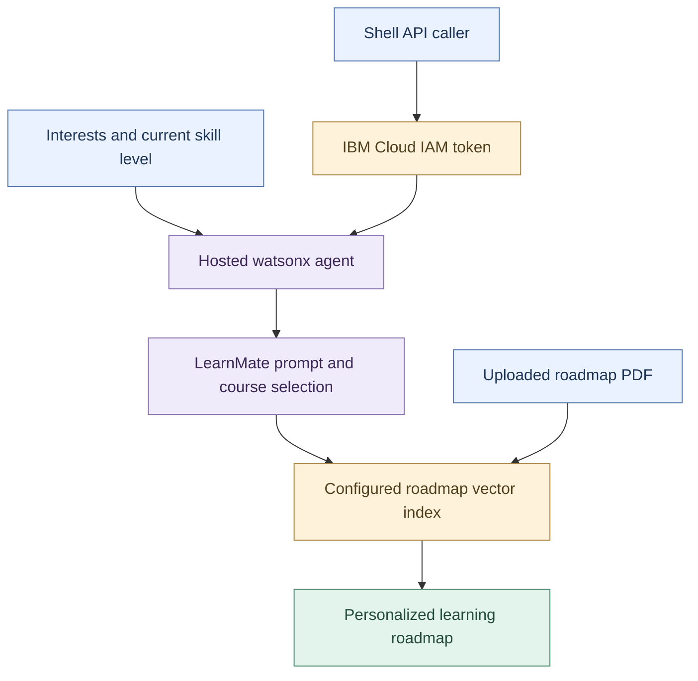

# learnmate-watsonx
Agentic AI for Personalized Course Pathways using IBM Watsonx

# LearnMate – Agentic AI for Personalized Course Pathways

LearnMate is an intelligent course path advisor built using IBM Watsonx. It interacts with students to understand their interests and skill level, then dynamically generates personalized learning roadmaps using foundation models and vector indexes.

## 🏗️ System Architecture

This repository supplies the agent prompt, a roadmap PDF, and an example API caller. The agent and document index must be configured in IBM watsonx; the diagram describes that hosted interaction, not an additional local backend.

<strong>Follow the implementation</strong>

| Stage | Source |
| --- | --- |
| Agent behavior | [learnmate_prompt.txt](learnmate_prompt.txt) |
| API invocation | [call_learnmate_agent.sh](call_learnmate_agent.sh) |
| Roadmap document | [course_roadmaps.pdf](course_roadmaps.pdf) |

## 🔍 Features
- AI Mentor using Watsonx foundation models (Granite)
- Adaptive course recommendations by skill level
- Course roadmap documents (PDFs) managed via vector index
  
## 📂 Repository Structure
- `agent/`: Prompt and agent logic
- `pdf/`: Course content used as knowledge base
- `json/`: Configurations for Watsonx agent setup

## 🚀 Technologies
- IBM Watsonx (Granite-13b, Prompt Lab, Vector Index)
- Python
- NLP, RAG

---

## About the developer

Built by **Pallavi Vholgade**. Explore my AI / ML projects, experience, and skills in my [portfolio](https://pallavi-portfolio-preview.vercel.app).

[LinkedIn](https://www.linkedin.com/in/pallavi-vholgade-05565b24b) · [Email](mailto:vhalgadepallavi45@gmail.com)
